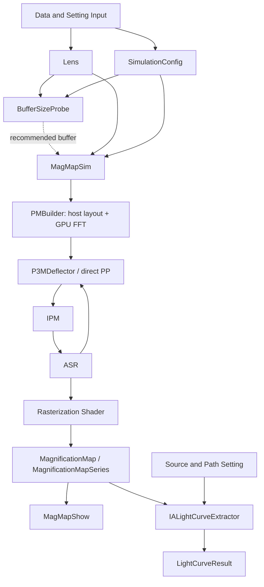

# DCLens

DCLens produces gravitational microlensing magnification maps with CUDA and
OpenGL, and extracts finite-source light curves from individual maps or evolving
snapshot sequences. The Python interface manages lens input, simulation settings,
GPU resource lifetimes, saved results and visualization.

Start with [Quick Start Guide](notebooks/Quick_Start_Guide.ipynb), an unexecuted
Jupyter notebook containing a small example catalogue, the complete pipeline,
explicit parameter examples and a full API reference.

## Contents

- [Installation and packaging](#installation-and-packaging)
- [Architecture](#architecture)
- [Input and output conventions](#input-and-output-conventions)
- [Quick start](#quick-start)
- [Public API reference](#public-api-reference)
- [Optional analysis API](#optional-analysis-api)
- [Resources and troubleshooting](#resources-and-troubleshooting)

## Installation and packaging

### System requirements

The native build uses Linux-style NVIDIA CUDA–OpenGL/EGL interoperability.
Use Python **3.10+**, an NVIDIA GPU and compatible NVIDIA driver, a CUDA Toolkit
including `nvcc` and cuFFT, a CUDA-compatible C++17 compiler, CMake **3.24+**,
Python development headers, and OpenGL/EGL development libraries. GPU map
simulation needs an NVIDIA-backed EGL/OpenGL context on the CUDA device.
A desktop window is not required by the offscreen renderer. macOS and native
Windows installation paths are not provided by this repository.

NumPy, pandas and Matplotlib are runtime dependencies. The PEP 517 build environment
installs setuptools, wheel, pybind11 and CMake; it does **not** install CUDA,
the NVIDIA driver, the system compiler or OpenGL/EGL development libraries.
For example, on a Debian/Ubuntu system the host development prerequisites can
be installed with:

```bash
sudo apt-get install build-essential python3-dev libopengl-dev libegl-dev
```

Install the CUDA Toolkit and compatible NVIDIA driver separately for your system.
Simulation, buffer probing and finite-source convolution use CUDA; there is no
CPU simulation fallback. Reading saved arrays and displaying maps do not require
loading the CUDA extension. Optional observational analysis runs separately.

### Install from a checkout

Run from the repository root in the intended Python environment:

```bash
python -m venv .venv
source .venv/bin/activate
python -m pip install --upgrade pip
# Set this only if CUDA is not discoverable through the normal toolchain paths:
export CUDA_HOME=/usr/local/cuda
python -m pip install .
```

For development, use `python -m pip install -e .`. For the notebook or optional
analysis routines, respectively:

```bash
python -m pip install -e '.[notebook]'
python -m pip install -e '.[analysis]'
# Both optional dependency groups:
python -m pip install -e '.[notebook,analysis]'
python -m jupyterlab notebooks/Quick_Start_Guide.ipynb
```

Select the kernel belonging to this environment. An existing Jupyter installation
can register it with `python -m ipykernel install --user --name dclens` after
installing the notebook extra. Reinstall after native source changes, a Python ABI
change or a CUDA toolchain change; restart Python/Jupyter after rebuilding.

### Build options

| Environment variable | Default | Meaning |
| --- | --- | --- |
| `CUDA_HOME` | unset | Toolkit root; forwards both toolkit path and `bin/nvcc` to CMake. |
| `CMAKE_CUDA_ARCHITECTURES` | `86` in CMake | Target GPU SM architecture(s); e.g. `86` or a semicolon-separated list. Select values supported by your toolkit and deployment GPU. |
| `CMAKE_BUILD_PARALLEL_LEVEL` | `2` | Number of parallel build jobs. |
| `CMAKE_ARGS` | empty | Additional shell-quoted CMake configure arguments, appended last. |

```bash
CMAKE_CUDA_ARCHITECTURES=86 CMAKE_BUILD_PARALLEL_LEVEL=2 \
  python -m pip install .
```

`setup.py` delegates to `CMakeLists.txt`; there is one native build definition.
For a standalone developer build:

```bash
cmake -S . -B build/native -DCMAKE_BUILD_TYPE=Release \
  -DPython_EXECUTABLE="$(command -v python)" -DCMAKE_CUDA_ARCHITECTURES=86
cmake --build build/native --parallel 2
```

This standalone path requires CMake and pybind11 already installed in the chosen
environment; without a custom output directory it writes the extension into
`DCLens/`. Normal pip builds place it in the wheel or editable build location.

### Create distributable packages

```bash
python -m pip install build
python -m build
# Produces a source archive and a platform/Python-specific wheel in dist/.
# On a compatible destination machine, using the actual generated filename:
python -m pip install /path/to/DCLens-wheel.whl
```

Replace the illustrative wheel path with a real `dist/*.whl` filename. A wheel
contains the compiled extension; it is not a universal Python wheel and does not
bundle the NVIDIA driver or all CUDA/OpenGL runtime libraries. Match the target
Python ABI, operating system, architecture and GPU/runtime environment. Installing
the source archive builds the extension and requires the development toolchain.
The source archive includes CUDA sources and the Quick Start notebook; the wheel
contains the importable package. No prebuilt binary availability is assumed.

## Architecture

The diagram's names correspond to the following implementation boundaries.
Connections follow the actual runtime dependencies:



| Stage | Code | Responsibility |
| --- | --- | --- |
| Lens | `DCLens/lens.py` | Lazy snapshot catalogue, distances and lens-plane count. |
| Settings | `DCLens/config.py` | Immutable `SimulationConfig`; image/source geometry belongs here. |
| BufferSizeProbe | `DCLens/buffer_size_probe.py` | Probe each snapshot; aggregate the recommended margin. |
| MagMapSim | `DCLens/mag_map_sim.py` | Stream snapshots and chunks, save maps and metadata. |
| Shared preparation | `DCLens/_pipeline.py` | Shared bounds, plane preparation and engine upload. |
| PMBuilder | `DCLens/physics/pm_builder.py`, `DCLens/src/p3m.cu` | Host mesh/bucket layout; GPU mass assignment and FFT fields. |
| P3MDeflector | `DCLens/src/p3m_deflector.cuh`, `p3m.cuh` | Multi-plane ray propagation and PM/PP field evaluation. |
| IPM | `DCLens/src/ipm.cu`, `ipm.cuh` | Cell/leaf records, queue ownership, refinement launches and boundary probe. |
| ASR | `DCLens/src/asr.cuh` | Corner mapping, distortion decision, child generation and leaf emission. |
| Rasterization Shader | `DCLens/src/rasterizer.cu`, `rasterizer.cuh` | Triangulation, GLSL additive rendering and supersample reduction. |
| Native coordination | `DCLens/src/engine.cu`, `engine.cuh`, `bindings.cu` | GPU lifetime management and private Python binding. |
| Map records | `DCLens/magnification_map.py` | In-memory maps, read-only mmap and sequence manifests. |
| MagMapShow | `DCLens/visualization.py` | Static plotting and the interactive light-curve view. |
| IALightCurveExtractor | `DCLens/lightcurve.py`, `src/lightcurve_extractor.*` | Continuous trajectories and streaming GPU source convolution. |
| Optional analysis | `DCLens/analysis/` | Observation matching and ensemble power spectra. |

PMBuilder spans host preprocessing and GPU FFT setup; the pipeline is not wholly
GPU-resident. IPM and ASR share the original kernel/queue organization. The new
headers are included in `ipm.cu`, preserving one translation unit and the existing
launch order. These stages are internal CUDA components, not independent Python
classes. `PMBuilder` is a public alias for the existing `apply_p3m_grid` host
function; it does not itself allocate GPU meshes.

The original `DCLens.simulation` and `DCLens.physics.p3m` import paths remain
available. Public root imports additionally expose `SimulationConfig` and
`PMBuilder`. Names beginning with `_`, including `DCLens._cuda`, are internal
implementation interfaces; use the documented Python API for normal workflows.

## Input and output conventions

A lens snapshot is a whitespace-separated text file with **one header line** and
at least these seven columns in order:

```text
M_Msun x_pc y_pc z_pc vx vy vz
1.0 -0.0001 0.0 0.0 0.0 0.0 0.0
1.0  0.0001 0.0 0.0 0.0 0.0 0.0
```

Masses are solar masses. Coordinates and distances are parsecs. File `z_pc` is
relative to `D_L_pc`: loaded `z_pc = file_z_pc + D_L_pc`. Entries with absolute
`z_pc <= 0` are discarded. Velocities are input columns only (conventionally
km/s); DCLens does not evolve or integrate them. A sequence must contain already
evolved snapshots. Public angular coordinates, regions, margins and pixel scales
are in **arcseconds**. Proper motion is arcseconds/year, light-curve time is days.

Maps use `array[row_y, col_x]`, lower origin and pixel-edge bounds. Source shape is
`ny=ceil(height/srcp_ps)`, `nx=ceil(width/srcp_ps)`: the upper edges can extend
slightly beyond the requested region due to pixel rounding. The lower edge is
computed from `img_center - src_considered_region/2`.

Single simulation outputs are a float32 `.npy` map and a same-stem `.json` sidecar.
The sidecar contains geometry, lens file/frame, all simulation controls, deflector
and P3M plane metadata, and timing. `save_sec` measures NPY writing; `total_sec`
ends before JSON metadata writing. A sequence writes:

```text
maps/
  map_000000.npy
  map_000000.json
  map_000001.npy
  map_000001.json
  manifest.json
```

The version-1 manifest references maps and sidecars relative to its own directory.
Move them together. It is published only after every frame succeeds; an interrupted
run can leave partial map output. Sequence simulation requires a fresh output
directory without a manifest or `map_*.npy` files. Single-map output can overwrite
an existing filename. Light curves use `.npz` with `time_days`, `magnification`,
`x`, `y`, and `frame_index`; no pickle is needed to read them.

## Quick start

Prepare `lens.dat` using the format above, then:

```python
from DCLens import (Lens, SimulationConfig, BufferSizeProbe, MagMapSim,
                    MagMapShow, IALightCurveExtractor)

lens = Lens('lens.dat', D_L_pc=1e4, D_S_pc=1e9, N_planes=1, pattern='*.dat')
# Small illustrative settings; these are not the library defaults.
config = SimulationConfig(
    coarse_ps=0.002, finest_ps=0.0005, PM_grid=128,
    src_considered_region=(0.04, 0.04), srcp_ps=0.0005,
    max_coarse_per_chunk=20, max_active_cells=200_000, ss=2,
)
buffer = BufferSizeProbe(lens, config=config, buffer_step=0.01,
                         max_buffer_steps=20, return_frames=False)
mmp = MagMapSim(lens, config=config, buffer_size=buffer,
                output='map.npy', save_dir='results', keep_in_memory=True)
fig, ax = MagMapShow(mmp)
extractor = IALightCurveExtractor(mmp, pmv_arcsec_yr=0.005, max_vram_mb=256)
curve = extractor.extract(start=(-0.01, 0.0), end=(0.01, 0.0),
                          source_radius_px=3, sample_dt_days=10.0)
curve.save('results/curve.npz')
```

The probe is an eight-control-point heuristic, not a proof that all images are
contained. Inspect its result for your science case. If it reaches the search
limit, increase `max_buffer_steps` and repeat before simulation.

For dynamic maps, pass a directory or an explicit file list to `Lens`:

```python
lens_sequence = Lens(['state0.dat', 'state1.dat'], D_L_pc=1e4,
                     D_S_pc=1e9, N_planes=1, pattern='*.dat')
probe = BufferSizeProbe(lens_sequence, config=config, return_frames=True)
series = MagMapSim(lens_sequence, config=config,
                   buffer_size=probe['recommended'], output=None,
                   save_dir='dynamic_maps', keep_in_memory=False)
extractor = IALightCurveExtractor(series, frame_dt_days=30.0,
                                 pmv_arcsec_yr=0.005, max_vram_mb=256)
curve = extractor.extract((-0.01, 0.0), (0.01, 0.0),
                          source_radius_px=3, sample_dt_days=1.0)
```

## Public API reference

All arguments below are listed, including defaults. `*` marks keyword-only
arguments. Methods with `self` use the instance and are shown without `self`.

### Lens

```python
from DCLens import Lens
Lens(source, D_L_pc=1e4, D_S_pc=1e9, N_planes=1, pattern='*.dat')
lens.load_frame(i)
lens.iter_frames()
```

| Parameter | Meaning |
| --- | --- |
| `source` | File path, directory path, or iterable of file paths. A directory uses natural filename order (`state2` before `state10`); an iterable preserves supplied order. Even a one-element iterable is a sequence. |
| `D_L_pc=1e4` | Reference lens distance in pc. |
| `D_S_pc=1e9` | Source distance in pc; finite `0 < D_L_pc < D_S_pc` is required. |
| `N_planes=1` | Positive integer plane count; splitting uses at most the number of retained lenses. |
| `pattern='*.dat'` | Glob pattern used only for directory input. |
| `i` | Zero-based snapshot index for `load_frame`; normal Python negative indexing also applies. |

Construction checks paths but does not load their tables. `load_frame(i)` returns
a pandas DataFrame with `x_pc`, `y_pc`, `M_Msun`, absolute `z_pc` and positive-distance
lenses. `iter_frames()` yields those tables lazily. `frame_count` is the number of
files; `files` is a tuple of absolute paths; `mode` is `'single'` or `'sequence'`.
These methods take no other parameters.

### SimulationConfig

```python
from DCLens import SimulationConfig
config = SimulationConfig(
    coarse_ps=1e-3, finest_ps=1e-4, distortion_threshold=0.2,
    PM_grid=2048, img_center=(0.0, 0.0), src_considered_region=(0.1, 0.1),
    buffer_size=0.1, max_refine_iters=20, srcp_ps=1e-4, ss=4,
    max_coarse_per_chunk=200, max_active_cells=20_000_000,
    p3m_a_pm_over_H=6.0, p3m_padding_factor=2.0,
    show_progress=True, verbose=False, deflector='p3m',
)
```

| Parameter | Default | Meaning |
| --- | --- | --- |
| `coarse_ps` | `1e-3` | Positive initial image-plane cell size, arcsec. |
| `finest_ps` | `1e-4` | Positive refinement stopping scale, arcsec. |
| `distortion_threshold` | `0.2` | Nonnegative triangle-area imbalance threshold. |
| `PM_grid` | `2048` | Positive integer active PM resolution on each axis, before padding. |
| `img_center` | `(0.0, 0.0)` | Finite `(x,y)` center in arcsec, used for image and source regions. |
| `src_considered_region` | `(0.1, 0.1)` | Positive `(width,height)` source region in arcsec. |
| `buffer_size` | `0.1` | Nonnegative image-plane margin added on each side, arcsec. |
| `max_refine_iters` | `20` | Positive integer maximum ASR iterations per chunk; unfinished refinement raises. |
| `srcp_ps` | `1e-4` | Positive source-map pixel size, arcsec/pixel. |
| `ss` | `4` | Positive integer raster supersampling factor per axis. |
| `max_coarse_per_chunk` | `200` | Positive integer coarse cells per chunk axis. |
| `max_active_cells` | `20_000_000` | Positive capacity of each active queue and result queue; at most `(2**31-1)//4`. |
| `p3m_a_pm_over_H` | `6.0` | Positive P3M splitting radius divided by mesh spacing. |
| `p3m_padding_factor` | `2.0` | Positive FFT-domain padding factor. |
| `show_progress` | `True` | Print chunk and output progress during simulation. |
| `verbose` | `False` | Enable detailed package/native diagnostics. |
| `deflector` | `'p3m'` | `'p3m'` or `'pp'`; PP sums all lenses per plane without PM/bucket setup. |

The dataclass is frozen. Use `dataclasses.replace(config, buffer_size=value)` for
a modified copy, or pass field overrides directly to the two functions below.
Overrides take precedence over `config` without mutating it. Unknown keywords are
rejected. PM settings are unused in PP mode but still undergo config validation.
The **20-million** queue capacity is the Python default; it alone consumes about
3.28 GiB when allocated. Small examples explicitly reduce it.

### BufferSizeProbe

```python
from DCLens import BufferSizeProbe
BufferSizeProbe(lens, *, config=None, buffer_step=0.01,
                max_buffer_steps=200, return_frames=False, **keywords)
```

| Parameter | Meaning |
| --- | --- |
| `lens` | A `Lens` instance. All snapshots are probed. |
| `config=None` | `SimulationConfig`; `None` constructs the defaults. |
| `buffer_step=0.01` | Positive candidate-margin increment in arcsec. |
| `max_buffer_steps=200` | Positive integer number of candidate margins. |
| `return_frames=False` | False returns a scalar maximum margin; true returns `{'recommended': scalar, 'frames': list}` in snapshot order. |
| `**keywords` | Any of the 17 `SimulationConfig` fields above, with exactly those defaults when no config is provided. |

The probe prepares the same selected deflector as simulation, but does not allocate
IPM queues or create a rasterizer. It searches with image bounds based on
`max_buffer_steps * buffer_step`; the configured `buffer_size` does not determine
this search range. Refinement, source pixel size, chunk size, supersampling and
simulation progress controls do not drive the boundary probe. The recommended
margin must be passed explicitly to `MagMapSim`; the input config is not modified.

### MagMapSim

```python
from DCLens import MagMapSim
MagMapSim(lens, *, config=None, output=None, save_dir=None,
          keep_in_memory=None, **keywords)
```

| Parameter | Meaning |
| --- | --- |
| `lens` | `Lens` instance, single or sequence. |
| `config=None` | `SimulationConfig`, or defaults when omitted. |
| `output=None` | Single-map filename/path; default `map.npy`. A missing `.npy` suffix is appended. Relative paths resolve under `save_dir`; an absolute path takes precedence. Must be `None` for sequences. |
| `save_dir=None` | Output directory; default current directory for single maps and `maps` for sequences. Created if necessary. |
| `keep_in_memory=None` | Single maps default to true, sequences to false. True is rejected for sequences. False keeps disk paths/metadata only. |
| `**keywords` | Any of the 17 config fields; per-call overrides take precedence. |

Returns `MagnificationMap` for a single file, or `MagnificationMapSeries` for a
directory/list input. Every map is saved even when retained in memory. One native
engine is reused through the run and closed in `finally`, including on failure.
Use the same region, lens geometry and deflector configuration for probing and
simulation. PP changes only deflection setup/evaluation; IPM, ASR and rasterization
retain their usual path.

### PMBuilder and lens-plane preparation

```python
from DCLens import PMBuilder
from DCLens.physics import split_into_planes, apply_p3m_grid
planes = split_into_planes(BH_table, N_planes)
planes = PMBuilder(lens_planes=planes, grid_nx=128, grid_ny=128,
                   theta_bounds_arcsec=None, a_pm_over_H=6.0,
                   padding_factor=2.0)
```

`split_into_planes(BH_table, N_planes)` takes a DataFrame with `x_pc`, `y_pc`,
`M_Msun`, **absolute** `z_pc`, and the requested integer number of planes. Use
`lens.load_frame(i)` as the table. It returns distance-ordered dictionaries,
with mean `z_pc` and `lenses` arrays (`x_pc`, `y_pc`, `M_Msun`), partitioned into
nearly equal lens counts. Empty input returns an empty list.

| PMBuilder parameter | Meaning |
| --- | --- |
| `lens_planes` | Plane list returned by `split_into_planes`. Modified in place and returned. |
| `grid_nx=128`, `grid_ny=128` | Positive active mesh resolutions; these low-level defaults differ from `SimulationConfig.PM_grid`. |
| `theta_bounds_arcsec=None` | Optional `(xmin,xmax,ymin,ymax)` image-ray footprint, arcsec; `None` uses lens extents. |
| `a_pm_over_H=6.0` | Positive cutoff/spacing ratio. |
| `padding_factor=2.0` | Positive FFT-box padding factor. |

The builder adds `p3m` dictionaries and stably reorders lens arrays by PP bucket.
Each dictionary contains `pm_nx`, `pm_ny`, `pm_xmin`, `pm_ymin`, `H`, `a_pm`,
`raw_nx`, `raw_ny`, `active_grid_nx`, `active_grid_ny`, `pp_nx`, `pp_ny`,
`pp_xmin`, `pp_ymin`, `pp_h`, `bucket_start`, `bucket_count`. Physical mesh
coordinates/spacing are in pc; bucket starts/counts are int32 arrays.
`PMBuilder` and `apply_p3m_grid` are the same function with the same signature.
Simulation calls this preparation automatically; advanced inspection does not
replace the normal `MagMapSim` input, which remains a `Lens`.

### MagnificationMap and MagnificationMapSeries

```python
from DCLens import MagnificationMap, MagnificationMapSeries
MagnificationMap(array=None, path=None, metadata={}, metadata_path=None)
MagnificationMapSeries(manifest)
mmp.load()
series.frame(i)
series.validate()
```

The displayed `metadata={}` represents a **fresh** dict per instance.

| Parameter | Meaning |
| --- | --- |
| `array=None` | Existing 2-D numeric NumPy map, retained without copying. |
| `path=None` | `.npy` path for disk access. At least `array` or `path` is required. |
| `metadata={}` | Map metadata dict; if empty, load the resolved metadata sidecar when available. |
| `metadata_path=None` | Explicit JSON sidecar path; otherwise discover same-stem `.json` beside `path`. |
| `manifest` | Version-1 sequence manifest path or directory containing `manifest.json`. |
| `i` | Frame index; normal Python indexing. |

`mmp.load()` returns the supplied array or a read-only NumPy memmap. It does not
cache a new in-memory copy. `series.frame(i)` returns a lazy `MagnificationMap`.
`series.frame_count`, `frames`, `geometry`, `simulation`, and `manifest_path`
expose manifest records. `series.validate()` checks all headers/sidecars and
common geometry without intentionally loading all pixels, returning `None`.
The loader methods have no other parameters. For arrays without metadata, give
`ps` and optionally `img_center` to display/extraction.

```python
mmp = MagnificationMap(array=None, path='results/map.npy',
                       metadata={}, metadata_path='results/map.json')
array = mmp.load()
series = MagnificationMapSeries(manifest='dynamic_maps/manifest.json')
first = series.frame(i=0)
```

### MagMapShow

```python
from DCLens import MagMapShow
MagMapShow(source, ps=None, *, frame=0, cut=0, img_center=(0.0, 0.0),
           vmin=0.5, vmax=None, sys_name='N-body Lens System', show=True)
```

| Parameter | Meaning |
| --- | --- |
| `source` | `MagnificationMap`, `MagnificationMapSeries`, 2-D NumPy array, `.npy` path, manifest path, or sequence directory. |
| `ps=None` | Arcsec/pixel. Required for an array/NPY without geometry metadata; if supplied with metadata it must agree. |
| `frame=0` | Frame index when the source is a series. |
| `cut=0` | Nonnegative integer pixels cropped from each edge for display only; must leave a nonempty map. |
| `img_center=(0.0,0.0)` | Arcsec center for geometry inferred without metadata. |
| `vmin=0.5` | Positive logarithmic lower limit; `None` also selects `0.5`. |
| `vmax=None` | Upper limit; default `max(shown.max(), vmin*1.01)`; must exceed lower limit. |
| `sys_name='N-body Lens System'` | Name inserted into the map title. |
| `show=True` | Call Matplotlib `show`; false allows saving/customizing first. |

Returns `(figure, axes)`, using `magma` and logarithmic normalization.
Example: `fig, ax = MagMapShow(mmp, show=False); fig.savefig('map.png')`.

### IALightCurveExtractor

```python
from DCLens import IALightCurveExtractor
IALightCurveExtractor(source, ps=None, *, frame_dt_days=None,
                     pmv_arcsec_yr=0.005, max_vram_mb=2048,
                     img_center=(0.0, 0.0), title_mmp='Magnification Map',
                     lc_title='Light Curve', gamma=0.1)
extractor.extract(start, end, source_radius_px=5, *, sample_dt_days=None)
extractor.show()
```

| Constructor parameter | Meaning |
| --- | --- |
| `source` | Same source types as `MagMapShow`; a series uses all snapshots. |
| `ps=None` | Arcsec/pixel; required without metadata, must agree with metadata otherwise. |
| `frame_dt_days=None` | Positive uniform snapshot duration in days, required for a sequence; unused for a single map. |
| `pmv_arcsec_yr=0.005` | Positive angular speed along the source path, arcsec/year. |
| `max_vram_mb=2048` | Positive requested extraction budget in MiB (despite the historical parameter name); `None` uses the same 2048 MiB cap. |
| `img_center=(0.0,0.0)` | Center in arcsec when geometry has no metadata. |
| `title_mmp='Magnification Map'` | Interactive map title. |
| `lc_title='Light Curve'` | Interactive curve title. |
| `gamma=0.1` | PowerNorm gamma for the interactive map display; does not change convolution. |

| `extract` parameter | Meaning |
| --- | --- |
| `start`, `end` | Finite `(x,y)` path endpoints in arcsec. |
| `source_radius_px=5` | Finite source size in pixels; uses `r=max(1,int(value))`. |
| `sample_dt_days=None` | Positive sampling interval in days; `None` uses approximately one sample per map pixel along the full path, at least ten for a nonzero full path. |

`extract()` returns `LightCurveResult`. The normalized discrete Gaussian has
`sigma=r/2` and square support `[-r,r]²`. Window centers use integer pixel
coordinates with the existing truncation convention, without interpolation.
Any window not entirely inside the map returns magnification `1.0`.

Travel duration is angular path length / proper motion × **365.25** days. Frame
`i` covers `[i*frame_dt_days,(i+1)*frame_dt_days)` with no temporal interpolation.
Sampling ends when the path ends or the sequence runs out; the final sequence
right boundary is excluded. A stationary path produces one sample at time zero.

Construction opens geometry/header data but does not plot or upload maps.
`show()` takes no arguments and returns `(figure,(map_axes,curve_axes))`. Click two
map positions for the start/end; move the radius slider (1–100 px) to update the
curve. The preview stays on frame zero even for dynamic extraction. Interactive
extraction uses the default `sample_dt_days=None`. For notebook interaction:

```python
%matplotlib widget
extractor.show()
```

Install the notebook extra first. Use `%matplotlib inline` for static figures;
it does not support the two-click interface. The UI uses a bounded preview while
convolution always uses the original map resolution.

### LightCurveResult

```python
from DCLens import LightCurveResult
LightCurveResult(time_days, magnification, x, y, frame_index)
curve.save(path)
```

The five required constructor arguments are aligned 1-D arrays: time in days,
dimensionless magnification, continuous x/y arcsec positions, and zero-based
snapshot indices (all zero for a single map). Normally use the object returned
by `extract()`. `save(path)` accepts a path, appends `.npz` if absent, creates
parents, writes the five named arrays and returns the resulting `Path`.
Existing output may be overwritten.

```python
import numpy as np
with np.load('results/curve.npz', allow_pickle=False) as data:
    time_days = data['time_days']
    magnification = data['magnification']
```

### Logging

`DCLens.logger.configure(verbose=False)` configures the package console logger;
`verbose=True` selects DEBUG, otherwise WARNING. It returns `None` and creates
no log file. Simulation/probing call it automatically. `show_progress` is a
separate simulation print control.

## Optional analysis API

Install `.[analysis]`. These modules preserve their separate scientific
conventions and are not implicitly imported by `import DCLens`. All module-defined
public functions are documented below; imported third-party functions are not
DCLens APIs. Analysis configuration dictionaries have no implicit defaults except
where explicitly listed.

### Observation matching

```python
from DCLens.analysis.observation import OBSandSIM_Match
cfg = dict(
    obs_csv='observations.csv', base_dir='observation_maps',
    output_dir='observation_results', output_csv='matches.csv',
    m_list=[1], rh_list=[1], N_list=[100], constraints={(1, 1): 100},
    source_size_pixels=5, proper_motion=0.005, pixel_scale=0.0005,
    random_seed=42, n_paths=100, filter_mode='relative', signal_threshold=0.05,
    replace_small_values=False, small_value_threshold=0.0, save_plots=True,
)
OBSandSIM_Match(cfg=cfg)
```

| `cfg` key | Meaning |
| --- | --- |
| `obs_csv` | CSV with `mjd`, `band`, `mag`, `magerr`; uses the most populated band. |
| `base_dir` | Directory containing `m_{m}_N{N}_rh_{rh}.npy` maps. |
| `output_dir`, `output_csv` | Directory and summary CSV filename. |
| `m_list`, `rh_list`, `N_list` | Parameter labels to scan; formatting must match filenames. |
| `constraints` | Mapping `(m,rh)` to **maximum** allowed N; absent combinations are skipped. |
| `source_size_pixels` | Gaussian radius parameter in px, sigma `int(radius)/2`, support to four sigma. |
| `proper_motion` | Angular motion, arcsec/year; uses 365.25 days/year. |
| `pixel_scale` | Map scale, arcsec/pixel. |
| `random_seed` | Seed accepted by NumPy's default RNG. |
| `n_paths` | Number of random horizontal paths attempted. |
| `filter_mode` | `'absolute'` for absolute peak-to-peak filtering; any other value uses peak-to-peak divided by mean. |
| `signal_threshold` | Minimum variation passing the chosen filter. |
| `replace_small_values` | Replace pixels at/below the threshold with 1 before convolution. |
| `small_value_threshold` | Replacement threshold, used when replacement is enabled. |
| `save_plots` | Save observation/PSD comparison images. |

`OBSandSIM_Match(cfg)` returns `None`; writes a summary only if results exist,
and optional `{map_name}_match.png` images. It retains full-map CPU FFT convolution,
noise addition, Lomb–Scargle power and the existing candidate criteria. It does not
consume `LightCurveResult` files or sequence manifests directly.

All lower-level functions in `DCLens.analysis.observation` are also callable:

| Function (complete signature) | Parameters and return |
| --- | --- |
| `make_pure_gaussian_kernel(r_px)` | Pixel radius; returns `(normalized_kernel, support_radius)`. `int(r_px)<1` returns a 1×1 unit kernel and radius 1. |
| `process_one_map(map_arr, kernel, r_px)` | 2-D map, normalized 2-D kernel, crop/support radius in px; returns `(convolved_map, valid_x_indices, valid_y_indices)`. |
| `is_signal_significant(flux, cfg)` | 1-D flux; dict with `filter_mode`, `signal_threshold`; returns a boolean. |
| `prepare_observation(csv_path)` | CSV path as above; returns `(relative_days, normalized_flux, flux_error, selected_band)`. |
| `extract_obs_matched_curves(conv_map, valid_x, valid_y, t_rel, flux_err_obs, cfg)` | Convolved 2-D map, valid integer coordinate arrays, observation relative days/errors; cfg needs `proper_motion`, `pixel_scale`, `random_seed`, `n_paths`, `filter_mode`, `signal_threshold`. Returns accepted noisy flux curves; no acceptance yields an empty array. |
| `calculate_criteria(f_obs, sim_fluxes, freqs, psd_obs, psd_sims)` | Observation flux `(T,)`, simulated flux `(n,T)`, frequencies `(F,)` in inverse days, observation power `(F,)`, simulated powers `(n,F)`; returns `(red_chi2, overlap_percent, obs_std, sim_mean_std, pull, median_psd, p16, p84, candidate_string)`. |
| `plot_and_save(t_obs, f_obs, f_err, sim_fluxes, freqs, psd_obs, median_psd, p16, p84, pull, map_name, save_dir)` | Relative days, flux/errors, simulated curves, frequencies and PSD summary arrays from the preceding functions, output stem and existing directory; saves `{map_name}_match.png`, returns `None`. |

A direct lower-level workflow (all parameters shown):

```python
import numpy as np
from astropy.timeseries import LombScargle
from pathlib import Path
from DCLens.analysis import observation as obs

t, f, err, band = obs.prepare_observation(csv_path=cfg['obs_csv'])
kernel, radius = obs.make_pure_gaussian_kernel(r_px=cfg['source_size_pixels'])
conv, vx, vy = obs.process_one_map(map_arr=mmp.load(), kernel=kernel, r_px=radius)
curves = obs.extract_obs_matched_curves(conv_map=conv, valid_x=vx, valid_y=vy,
                                       t_rel=t, flux_err_obs=err, cfg=cfg)
if len(curves):
    significant = obs.is_signal_significant(flux=curves[0], cfg=cfg)
    freqs = np.logspace(np.log10(1/(t.max()+1)),
                        np.log10(0.5/np.median(np.diff(t))), 150)
    p_obs = LombScargle(t, f).power(freqs)
    p_sims = np.array([LombScargle(t, row).power(freqs) for row in curves])
    criteria = obs.calculate_criteria(f_obs=f, sim_fluxes=curves, freqs=freqs,
                                      psd_obs=p_obs, psd_sims=p_sims)
    _, _, _, _, pull, median, p16, p84, _ = criteria
    Path(cfg['output_dir']).mkdir(parents=True, exist_ok=True)
    obs.plot_and_save(t_obs=t, f_obs=f, f_err=err, sim_fluxes=curves,
                      freqs=freqs, psd_obs=p_obs, median_psd=median,
                      p16=p16, p84=p84, pull=pull, map_name='example',
                      save_dir=cfg['output_dir'])
```

Use an observation cadence and duration that fit within the map's available
horizontal path. Real observations should contain enough distinct times for the
retained frequency construction. The four-sigma source model here differs from
the interactive extractor's truncated square; the two are not silently unified.

### Ensemble power spectra

```python
from DCLens.analysis.power_spectrum import compute_group_psd_matrix
info = compute_group_psd_matrix(
    fluxes=fluxes, times=times, psd_mode='fft', nperseg_default=256,
    n_freq_bins=120, welch_window='hann', welch_detrend='linear',
)
```

| Parameter | Default | Meaning |
| --- | --- | --- |
| `fluxes` | required | Nonempty real ensemble `(n_samples,T)`. |
| `times` | required | Common uniformly spaced time array `(T,)` in **years**, with enough samples for distinct positive frequency bins; the routine derives cadence from the first interval. |
| `psd_mode` | `'fft'` | `'fft'` periodogram or `'welch'`. |
| `nperseg_default` | `256` | Welch segment length, capped at T. |
| `n_freq_bins` | `120` | Number of common logarithmic frequency bins. |
| `welch_window` | `'hann'` | SciPy Welch window specification. |
| `welch_detrend` | `'linear'` | SciPy Welch detrending specification. |

Returns a dict with `freq_grid` (1/day), `X_log` (log10 PSD for each curve),
`median_log10`, `dt_days`, `fs` (1/day), and `n_samples`. This existing routine
uses **365 days/year**, unlike the trajectory's 365.25. To preserve day spacing
when adapting a uniformly sampled `LightCurveResult`, explicitly set
`times=curve.time_days/365.0`, `fluxes=curve.magnification[None,:]`. Do not pass a
nonuniform final endpoint to this uniformly sampled PSD routine; select/resample
a uniform segment first. Native ensemble files have arrays `fluxes` and `times`;
they are not the same format as `LightCurveResult.save()`.

```python
from DCLens.analysis import power_spectrum as psd
cfg_psd = dict(
    out_dir='psd_results', m_list=[1], N_list=[100], rh_list=[1],
    constraints={(1, 1): 100}, source_size_pixels=5,
    psd_mode='fft', nperseg_default=256, n_freq_bins=120,
    welch_window='hann', welch_detrend='linear',
    figsize=(10, 6), xscale='log', markevery=10, markersize=4,
    line_width=1.5, line_alpha=0.8, label_fontsize=12,
    legend_fontsize=10, legend_title_fontsize=11,
    output_fig_name='psd_groups.png', dpi=150, n_single_samples=3,
)
groups = psd.plot_psd_by_params(cfg=cfg_psd, single_samples=False)
```

`plot_psd_by_params(cfg, single_samples=False)` reads
`LC_m{m}_N{N}_rh{rh}_R{source_size_pixels}.npz` in `out_dir`, writes per-group
`psd_median_{combo}_{mode}.csv`, a `psd_summary_{mode}.csv`, and the configured
figure, shows the plot and returns a dict keyed by combo name. Missing files are
skipped; no available groups raises. Configuration keys:

| Keys | Meaning / defaults |
| --- | --- |
| `out_dir` | Input ensemble directory and output directory, required. |
| `m_list`, `N_list`, `rh_list` | Parameter labels and plotting legend order, required. |
| `constraints` | `(m,rh)` → **minimum** N allowed, required; this is intentionally opposite to observation matching. |
| `source_size_pixels` | Radius token in input filenames, required. |
| `psd_mode`, `nperseg_default`, `n_freq_bins` | Required; semantics as `compute_group_psd_matrix`. |
| `welch_window`, `welch_detrend` | Optional, defaults `'hann'`, `'linear'`. |
| `figsize` | Figure `(width,height)` in inches, required. |
| `xscale` | `'log'` for logarithmic frequency axis, otherwise linear, required. |
| `markevery`, `markersize` | Matplotlib marker spacing and size, required. |
| `line_width`, `line_alpha` | Median line width and opacity, required. |
| `label_fontsize`, `legend_fontsize`, `legend_title_fontsize` | Font sizes, required. |
| `output_fig_name`, `dpi` | Output figure name and resolution, required. |
| `n_single_samples` | Optional number of randomly drawn individual spectra when `single_samples=True`; default 3. |

Single-file plotting:

```python
info = psd.plot_single_npz_psd_with_1sigma(
    npz_path='psd_results/LC_m1_N100_rh1_R5.npz',
    cfg=dict(psd_mode='fft', nperseg_default=256, n_freq_bins=120,
             welch_window='hann', welch_detrend='linear', figsize=(8, 6),
             xscale='log', label_fontsize=12, title='PSD example',
             title_fontsize=14, legend_fontsize=10,
             out_dir='psd_results', output_fig_name='single.png', dpi=300),
)
```

`plot_single_npz_psd_with_1sigma(npz_path, cfg)` returns the PSD dict, shows median,
16th/84th percentile band and up to three random members. All its cfg keys are
optional: defaults are the values shown above, except `title` defaults to
`PSD Analysis for {filename}`, and no image is saved unless **both** `out_dir`
and `output_fig_name` are present. `dpi=300` applies when saving. It does not use
the batch-only parameter lists, constraints, styles or `n_single_samples`.

Additional complete helper signatures:

| Function | Parameters and return |
| --- | --- |
| `iter_valid_combinations(cfg)` | Dict containing `m_list`, `rh_list`, `N_list`, `constraints`; yields `(m,N,rh)` with `N >= constraints[(m,rh)]`. |
| `combo_name(m, N, rh)` | Three parameter labels; returns `m{m}_N{N}_rh{rh}`. |
| `resolve_latest_npz(out_dir, combo_name_str, r_px=5)` | Directory, combo name string, radius filename token; returns the newest matching `LC_{combo}_R{r_px}.npz` path or `None`. |

```python
combinations = list(psd.iter_valid_combinations(cfg=cfg_psd))
name = psd.combo_name(m=1, N=100, rh=1)
path = psd.resolve_latest_npz(out_dir=cfg_psd['out_dir'],
                              combo_name_str=name, r_px=5)
```

## Resources and troubleshooting

- **Memory:** the Python default `max_active_cells=20_000_000` reserves two
  48-byte cell queues and one 80-byte leaf queue, about 3.28 GiB, only when IPM
  runs. Start with smaller explicit capacities/chunks on constrained GPUs.
  Raster targets scale as `nx * ny * ss²`; PM FFT dimensions also grow with
  padding and power-of-two rounding. Default settings are not guaranteed to
  fit every GPU.
- **Queue capacity or unfinished refinement:** reduce `max_coarse_per_chunk`,
  or select an appropriate larger `max_active_cells` / `max_refine_iters`.
  These choices retain the existing numerical implementation but can affect
  resource use; scientific resolution settings should be chosen deliberately.
- **Extraction:** buffers use a budget of
  `0.8 * min(requested MiB, 0.5 * currently free GPU bytes)` after unit conversion.
  Maps are read-only mmap when disk-backed; only required path regions are
  uploaded. Batches shrink on memory pressure, and failure to fit one source
  window raises. Whole maps are not retained for a sequence.
- **Import/build errors:** use the Python environment in which DCLens was
  installed; rebuild after native changes. Ensure `nvcc`, CUDA headers/libraries,
  Python headers, and OpenGL/EGL development files are discoverable. Change
  `CMAKE_CUDA_ARCHITECTURES` when the default SM 86 is inappropriate. Stale local
  extensions can shadow a separately installed package when running in a checkout.
- **EGL/interoperability errors:** the renderer requires NVIDIA-backed OpenGL/EGL
  and access to the matching CUDA device, including inside containers. A software
  OpenGL implementation is insufficient for this GPU interop path.
- **Output directory exists:** select a fresh directory for sequence simulation.
  The simulator does not resume a partial sequence automatically.
- **No interactive clicks:** enable `%matplotlib widget` with `ipympl`, or use
  a desktop interactive Matplotlib backend. Programmatic `extract()` needs no GUI.
- **Scientific conventions:** TSC assignment, P3M force splitting, plane
  propagation, IPM area/refinement criteria, short-diagonal triangulation,
  additive R32F rendering, supersampling and float32 chunk accumulation retain
  their existing implementations. The buffer heuristic, full coarse-cell extent
  at partial edge chunks, and separate analysis source/time conventions are
  retained as well.

The Quick Start notebook is distributed without precomputed outputs.

## Earlier version

The pre-refactor implementation is preserved under the
[`legacy-before-refactor` tag](https://github.com/Teamf547/DCLens/tree/legacy-before-refactor).
